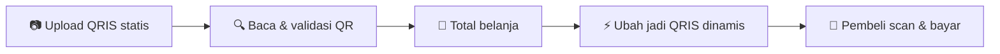

<div align="center">

# 🧾 KasirKu

**Aplikasi kasir Android yang simpel, cepat, dan langsung bisa terima pembayaran QRIS dengan nominal otomatis.**

[](https://developer.android.com)
[](https://kotlinlang.org)
[](https://developer.android.com/jetpack/compose)
[](https://github.com/BagasExpoit/kasirku/releases)
[](https://github.com/BagasExpoit/kasirku/actions)

### [⬇️ Unduh kasirku.apk](https://github.com/BagasExpoit/kasirku/releases/latest/download/kasirku.apk)

</div>

---

## ✨ Fitur

| | |
|---|---|
| 🛒 **Kasir** | Tambah, ubah, dan hapus barang dengan harga satuan & jumlah. Total dihitung otomatis. |
| 💵 **Uang & kembalian** | Isi uang pembeli, tekan **Uang pas** atau pecahan cepat, kembalian langsung muncul. |
| 📱 **QRIS dinamis** | Upload QRIS statis tokomu sekali, lalu tiap transaksi KasirKu membuat QR dengan **nominal terkunci** sesuai total belanja. |
| 🏪 **Profil toko** | Atur nama toko dan nomor HP. Tombol **Simpan** menjaga data tetap ada saat aplikasi dibuka lagi. |
| 🌗 **Tema terang & gelap** | Ikuti tema sistem atau ganti manual dari tab Toko. |
| 👨‍💻 **Halaman Pengembang** | Info versi aplikasi dan tautan kontak pengembang. |

> 🔒 **Privasi:** data toko dan barang disimpan lokal di perangkat. Aplikasi tidak meminta izin apa pun di manifest, termasuk internet.

## ⚡ Cara kerja QRIS dinamis


KasirKu membaca payload QRIS (standar EMVCo Merchant-Presented QR) memakai [ZXing](https://github.com/zxing/zxing), lalu:

1. Mengubah tag `01` dari statis (`11`) menjadi dinamis (`12`).
2. Menyisipkan tag `54` berisi nominal transaksi.
3. Menghitung ulang checksum **CRC16-CCITT** pada tag `63`.
Hasilnya adalah QR baru yang nominalnya sudah terisi, jadi pembeli tidak perlu mengetik jumlah.
## 🚀 Cara pakai
1. Buka tab **Toko**, isi nama toko dan nomor HP, lalu tekan **Simpan Semua Perubahan**.
2. Buka tab **QRIS**, upload gambar QRIS statis tokomu. Coba dulu dengan **Nominal uji coba**.
3. Buka tab **Kasir**, tekan **Tambah Barang**, isi nama, harga satuan, dan jumlah.
4. Pilih **Bayar QRIS** dan minta pembeli scan, atau isi **Uang pembeli** untuk pembayaran tunai.
5. Tekan **Transaksi Baru** untuk memulai pesanan berikutnya.
## 🛠️ Teknologi

| Komponen | Versi |
|---|---|
| Bahasa | Kotlin 2.0.21 |
| UI | Jetpack Compose (BOM 2024.12.01) + Material 3 |
| QR | ZXing core 3.5.3 |
| Build | Android Gradle Plugin 8.7.3, Gradle 8.10.2 |
| Target | `minSdk` 26 (Android 8.0), `targetSdk` & `compileSdk` 35 |
| JDK | 17 |

## 📂 Struktur proyek
```
app/src/main/java/com/kasirku/app/
├── MainActivity.kt      # Aktivitas utama + navigasi 4 tab
├── KasirScreen.kt       # Tab Kasir: barang, total, uang pembeli, bayar QRIS
├── TokoScreen.kt        # Tab Toko: nama, nomor HP, mode gelap, simpan
├── QrisScreen.kt        # Tab QRIS: upload, validasi, uji nominal
├── DevScreen.kt         # Tab Pengembang
├── KasirViewModel.kt    # State aplikasi + penyimpanan lokal
├── Qris.kt              # Parser, validator, konversi statis -> dinamis, CRC16
├── Theme.kt             # Tema terang/gelap
└── BrandIcons.kt        # Ikon merek
```
## 👨‍💻 Pengembang

**Bagas**

[](https://github.com/BagasExpoit)
[](https://facebook.com/willydevops1)
[](https://www.instagram.com/bagas_samuji74)

## 🤝 Kontribusi

Menemukan bug atau punya ide fitur? Buka [Issue](https://github.com/BagasExpoit/kasirku/issues) atau kirim Pull Request.

---

<div align="center">

Dibuat dengan ❤️ di Indonesia

</div>
